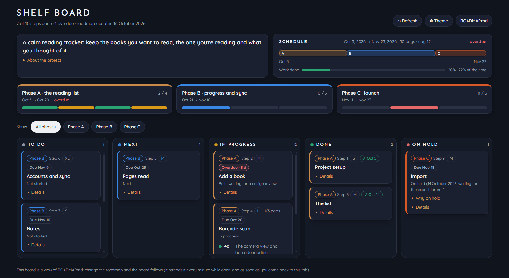

# Project board

Plan a project with your AI agent and watch it on a live kanban board.

You describe the project. The agent plans it in one file, `ROADMAP.md`, as phases, steps, parts and due dates, and
sets up a board that shows it. As work goes on, the agent keeps the roadmap up to date, and the board follows:
cards fly to their new column, overdue steps turn red, and the timeline shows whether you're on track.



- **One source of truth:** a readable Markdown file in your repo. No accounts, no database, no build step.
- **Dates done right:** a script works out every due date from effort sizes, working days and days off.
  It also reschedules what's left when something slips.
- **Works offline:** the board is a single HTML page, opened with a tiny local server.
- **Documentation that stays current:** the agent also writes `README.md`, with a map of which file controls what,
  and `CLAUDE.md`, with where to start reading and the project's standing rules, and updates both as it works. A
  new team member, or a new agent session, reads the map instead of the whole codebase (far fewer tokens).

## Install (Claude Code)

In Claude Code:

```
/plugin marketplace add Chithamalai-Karthik/project-board
/plugin install project-board@project-board
```

Or from a terminal:

```bash
claude plugin marketplace add Chithamalai-Karthik/project-board
claude plugin install project-board@project-board
```

The board and its scripts need Python 3.8+ (no packages).

**Updates:** `/plugin marketplace update project-board` and then `/plugin update project-board@project-board`. Or
turn on auto-update in `/plugin` → Marketplaces.

## Use

In any project folder, ask the agent, for example:

- "Plan this project with the project board", or `/project-board:plan`
- "Open the board"
- "Step 4 is done" (the agent also does this by itself while it works)
- "We're behind: reschedule the rest"
- "Document this project" (for a project that already has a roadmap, or none)

The agent sets up `board/` in the project (the page, a tiny server, the format and the scheduling script) and asks
a few questions: what the project is, the start date, any deadline, days a week, and anything later sessions must
never touch. Then it writes `ROADMAP.md` with dates, `README.md` and `CLAUDE.md`, and shows you the plan to approve.
An existing README or CLAUDE.md is never overwritten: the agent offers to add only the sections that are missing.

Open the board with:

```bash
python board/serve.py
```

This opens `http://localhost:8790/board/` (only reachable from your own computer). The board reads `ROADMAP.md` every
minute while it's on screen and as soon as you come back to the tab.

## Without Claude Code

Everything in a project's `board/` folder works on its own, with Python 3.8+:

```bash
python board/serve.py                                   # open the board
python board/roadmap.py check ROADMAP.md                # check the format and the dates
python board/roadmap.py schedule ROADMAP.md --start 2026-11-02 --days-per-week 5 --write   # work out the due dates
python board/roadmap.py schedule ROADMAP.md --from-today --write                           # reschedule what's left
```

To set up a project by hand, copy `plugins/project-board/skills/plan/board/`, `FORMAT.md` and `scripts/roadmap.py`
into `<project>/board/`, and start from `templates/ROADMAP.md` (and `templates/README.md`, `templates/CLAUDE.md`). Other AI agents can follow
`plugins/project-board/skills/plan/SKILL.md`: it's plain Markdown in the open Agent Skills format.

## Try the demo

```bash
python plugins/project-board/skills/plan/board/serve.py --root examples/demo
```

## Presentation

`presentation/index.html` introduces the plugin to a team: a few slides and a guided tour of a made-up project, with a
scripted chat and a working board. It works offline: open the file in a browser. Keys: → or Space next, ← back,
F full screen, T light or dark, M board or ROADMAP.md, R restart the tour. `presentation/handout.html` is a one-page
handout that prints on A4. The fonts (Josefin Sans, Quicksand) are under the SIL Open Font License, in
`presentation/fonts/`.

## What's in here

| Path | What |
| --- | --- |
| `.claude-plugin/marketplace.json` | makes this repo a Claude Code plugin marketplace |
| `plugins/project-board/.claude-plugin/plugin.json` | the plugin (name, version) |
| `plugins/project-board/skills/plan/SKILL.md` | the agent's instructions: set up, interview, plan, schedule, write the docs, keep it all live |
| `.../plan/FORMAT.md` | the roadmap format the board reads |
| `.../plan/board/index.html`, `serve.py` | the board, and the local server that opens it |
| `.../plan/scripts/roadmap.py` | `init`, `check` and `schedule` |
| `.../plan/templates/ROADMAP.md`, `README.md`, `CLAUDE.md` | the starting roadmap and docs |
| `examples/demo/` | a sample project, part way through |
| `presentation/` | the slides and tour, and the one-page handout |

## Releasing a change

Edit the files, bump `version` in `plugins/project-board/.claude-plugin/plugin.json` (users only get a new version
when it changes), check with `claude plugin validate .`, and push.

## Licence

MIT: see [LICENSE](LICENSE).
